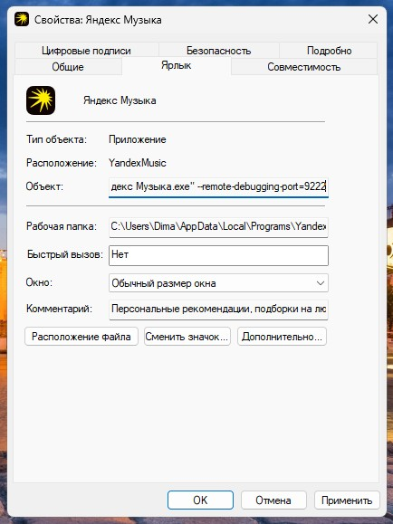
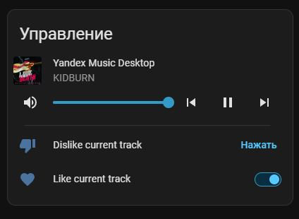
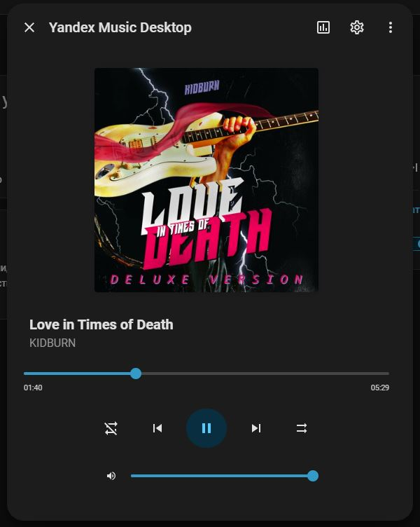
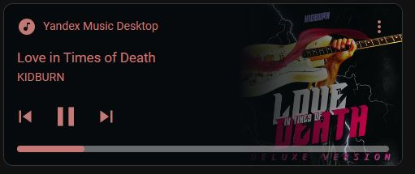

# yandex-music-desktop-home-assistant
Интеграция для управления приложением [Яндекс музыка](https://music.yandex.ru/download/) в Home Assistant

# Подготовка приложения

Нужно в настройки ярлыка добавить

```
--remote-debugging-port=9222
```
или любой другой свободный порт



Запустите приложение с ярлыка и в командной строке запустите команду

```
curl.exe http://127.0.0.1:9222/json/list
```

Вы должны получить ответ.

После нужно настроить доступ извне к вашей программе Яндекс музыка

В командной строке запустите

```
netsh interface portproxy add v4tov4 listenaddress=192.168.1.95 listenport=19222 connectaddress=127.0.0.1 connectport=9222
```

где 192.168.1.95 - адрес ПК на котором запускается программа, а 19222 - порт по которому мы будем осуществлять доступ (порт может быть любым)

После настройки проверьте в командной строке, что все настройки работают

```
curl.exe http://192.168.1.95:19222/json/list
```

Должны получить аналогичный ответ, что и ранее.

Теперь можно устанавливать интеграцию и настраивать.








За идею как управлять приложением Яндекс музыка спасибо [@whxtelxs](https://github.com/whxtelxs) и его плагину https://github.com/whxtelxs/Yandex-Music-Ajazz-Plugin
